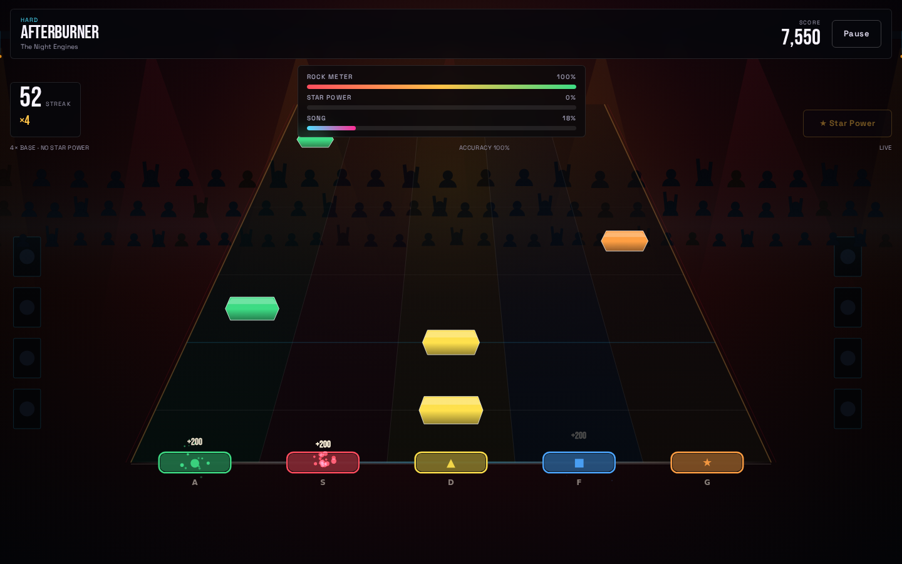
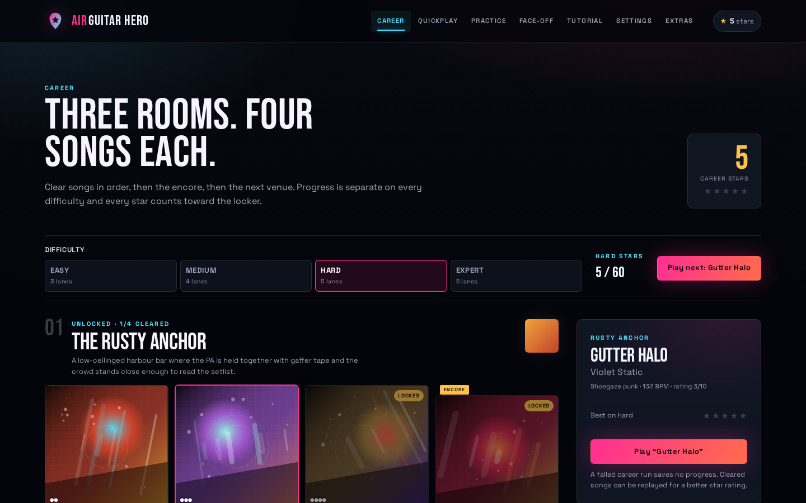
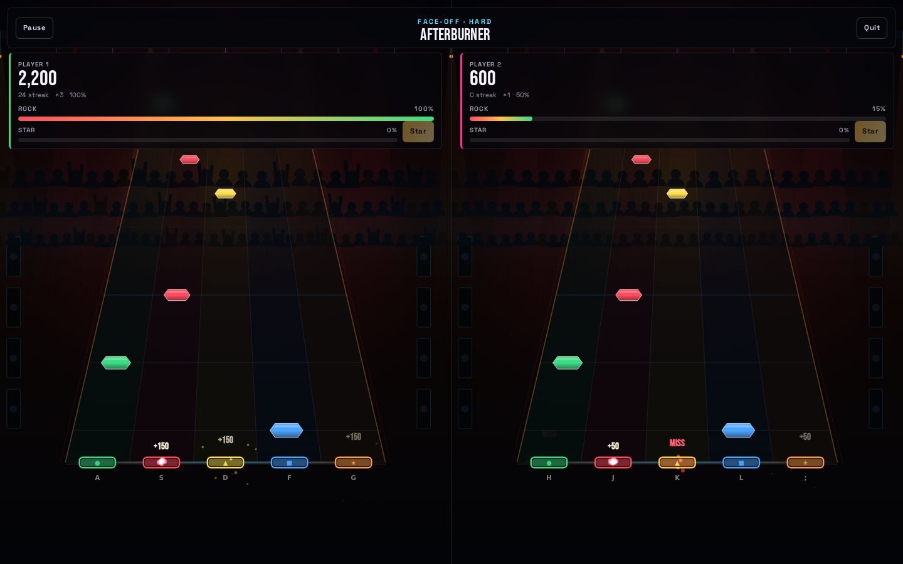
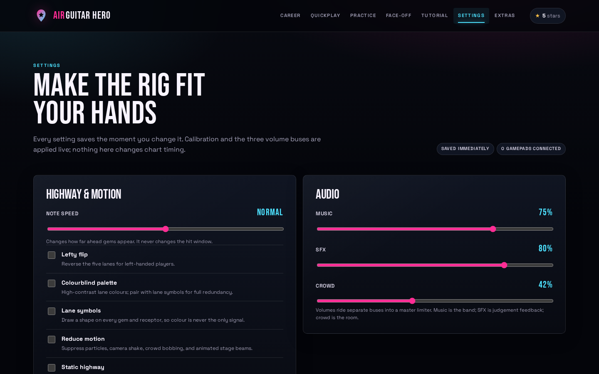

# Air Guitar Hero


**Five lanes. Twelve original songs. One browser tab.**

[**Play Air Guitar Hero →**](https://gerrcass.github.io/air-guitar-hero/)

Air Guitar Hero is a feature-complete, single-page guitar game built with React, TypeScript,
Canvas 2D, and Web Audio. It has the full five-fret vocabulary — chords, sustains, hammer-ons,
star power, whammy, a rock meter, and four difficulty ladders — with an entirely original,
synthesized soundtrack and no server.

[](https://gerrcass.github.io/air-guitar-hero/)

## What's in the game

- **Twelve original tracks** across three venues, each with its own tempo, key, palette,
  arrangement, chart, and procedural album art. Audio and charts are generated from the same
  deterministic song data, so sync is structural.
- **Four real charts per song:** Easy (3 lanes, no chords), Medium (4 lanes, dyads), and
  Hard/Expert (5 lanes, full chords, sustains, HOPOs).
- **Career:** three venues with three songs and an encore each, separate progress on every
  difficulty, one-to-five-star ratings, and six unlockable guitar finishes.
- **Quickplay:** every song and difficulty from the first visit, with remembered selections and
  best score, stars, accuracy, and streak per song/difficulty.
- **Practice:** real chart sections, 50–100% speed, looping, no fail, and no writes to career or
  best scores.
- **Interactive tutorial:** five short rep-based lessons for single notes, chords, sustains,
  star power, and HOPOs.
- **Local face-off:** split-screen two-player Pro Face-Off on one chart, with independent
  scores, streaks, rock meters, and star power. First to fail loses; if both survive, the
  higher score wins.
- **Accessibility and input:** keyboard and standard-mapping gamepad support, hot-plug,
  calibration, colourblind palette, lane symbols, reduced motion, static highway, camera-shake
  toggle, separate music/SFX/crowd buses, full keyboard navigation, live HUD status, and a
  visible audio-error recovery screen.

### Modes at a glance

| Mode | What it is |
| --- | --- |
| Career | The per-difficulty ladder. Clear in order; the encore opens the next venue. |
| Quickplay | The whole setlist, immediately, with saved bests. |
| Practice | Section loops and slower tempos, with no fail. |
| Tutorial | Five short lessons, replayable, with a saved completion marker. |
| Face-off | Two players, one chart, one machine. |

## Controls

### Keyboard

| Action | Player 1 | Player 2 |
| --- | --- | --- |
| Frets (green → orange) | `A` `S` `D` `F` `G` | `H` `J` `K` `L` `;` |
| Strum | `Space` | `Right Shift` or `Enter` |
| Star power | `Q` (or `Enter` in solo) | `P` |
| Whammy | `W` | `O` |
| Pause | `Escape` | `Escape` |

### Gamepad (standard mapping)

| Action | Mapping |
| --- | --- |
| Frets | A / B / X / Y / RB (buttons 0–3, 5) |
| Strum | LB / LT / RT (buttons 4, 6, 7) |
| Star power | Start (button 9) |
| Whammy | Left-stick click (button 10) |
| Menus | D-pad or left stick to move, A to select; left/right adjusts range fields |

The first connected pad drives Player 1; a second pad drives Player 2 in Face-off. Menus are
fully keyboard operable; gameplay needs a keyboard or gamepad. Mobile menus are usable and the
shell says so.

## Run it locally

Requires Node 22 and npm.

```sh
npm ci
npm run dev          # http://localhost:5173/air-guitar-hero/
```

Production and quality commands:

```sh
npm run check        # tsc + Biome + Vitest + content validation
npm run test:e2e     # Chromium journeys, axe scans, responsive and frame-budget checks
npm run build        # production build under /air-guitar-hero/
npm run screenshots  # build, serve, and capture docs/screenshots/
```

The production build works under the GitHub Pages project path and uses hash routing, so a
refresh on any route loads the app.

## Saves and privacy

The game is client-only. Career progress, best scores, unlocks, the tutorial marker, and all
settings live in one versioned localStorage document under `air-guitar-hero.save.v1`. Corrupt or
older saves fall back to a fresh save instead of breaking the app; Settings has a confirmed reset
action. No account, backend, analytics, or network calls are involved at runtime.

## Docs

- [Architecture](docs/engineering/ARCHITECTURE.md)
- [Design decisions](docs/design/DESIGN-GRILL.md)
- [Glossary](GLOSSARY.md)
- [Coding standards](CODING_STANDARDS.md)
- [Architecture decisions](docs/adr/)
- [Review log](docs/engineering/REVIEW_LOG.md)
- [Performance notes](docs/engineering/PERFORMANCE.md)
- [Release checklist](docs/engineering/RELEASE.md)

## Assets and licensing

**All music and art are original to this project.** Every track is synthesized at runtime from
deterministic song data; no recorded audio, samples, or third-party artwork are bundled. Album
covers and stage visuals are generated procedurally in the app. There is no licensed music and no
Guitar Hero catalogue, logo, or protected expression in the product.

Typefaces are self-hosted through Fontsource: **Bebas Neue** and **Space Grotesk**, both under the
SIL Open Font License. The project code is MIT licensed. “Air Guitar Hero” is the name of this
project and a love letter to the five-fret genre.

## More screenshots

| Career | Results |
| --- | --- |
|  |  |

| Face-off | Settings |
| --- | --- |
|  |  |
